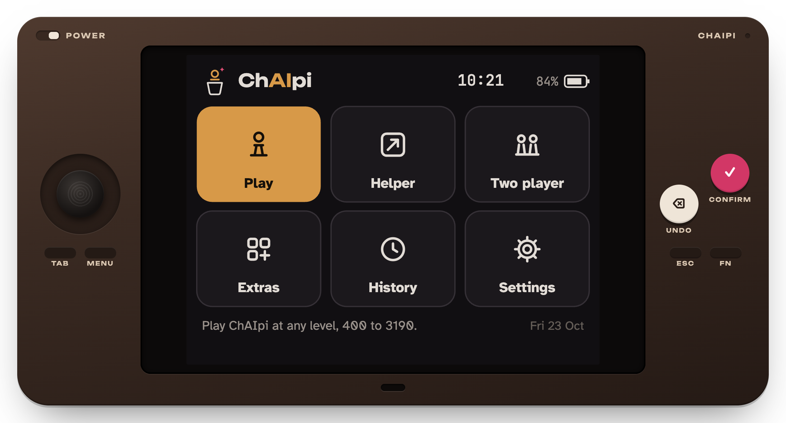
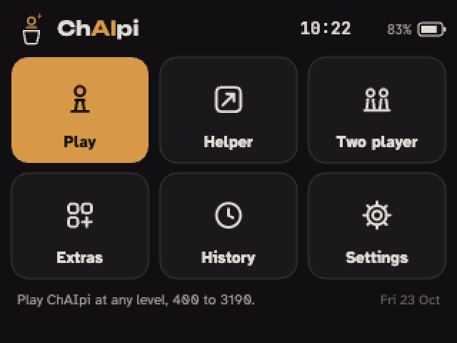
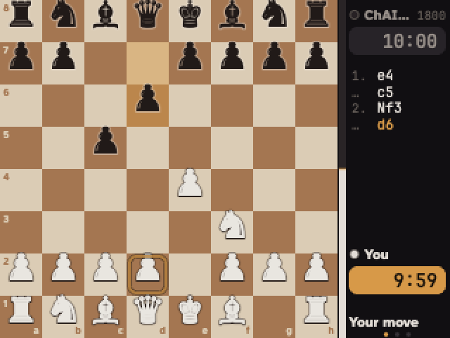
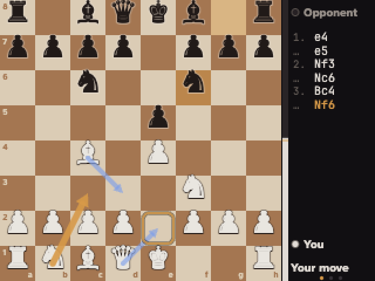
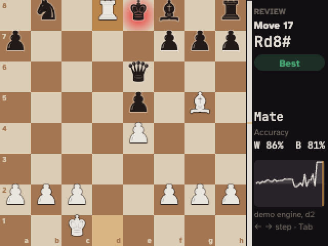
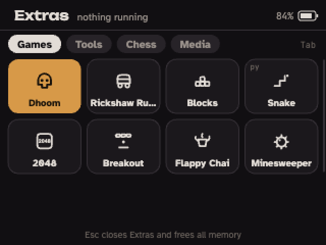
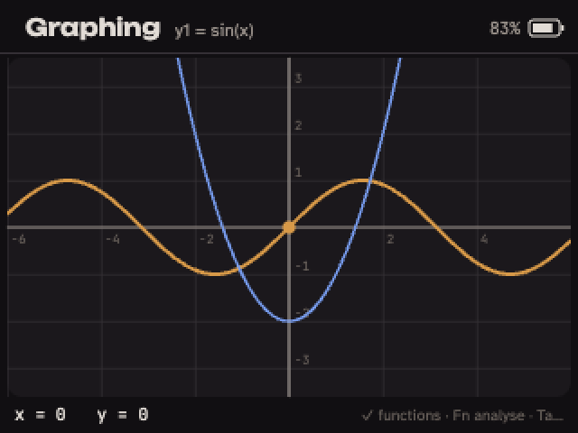
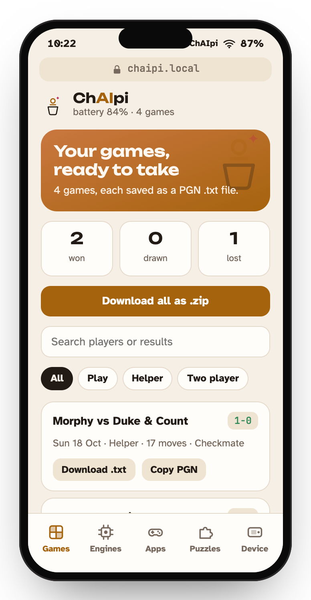
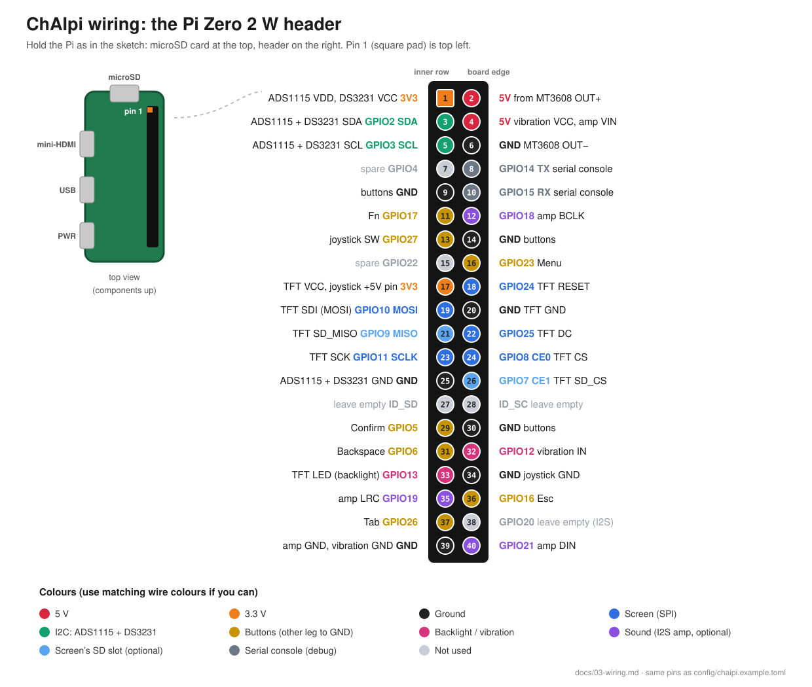

<div align="center">



# ChAIpi

**A pocket chess computer: Stockfish 19 on a Raspberry Pi Zero 2 W, with a 2.8" colour screen, a joystick and six buttons.**

**[⬇ Download the latest release](../../releases/latest)**

[Try the emulator](#try-it-in-your-browser) · [Flash the SD card](#flash-the-sd-card) · [Build one](#build-one) · [Parts list](docs/parts-list.md) · [Docs](docs/README.md)


</div>

ChAIpi plays chess against you at any level from 400 to 3190 Elo, sits next to a real board and suggests moves, keeps a clock for two players, and reviews your games afterwards. Every game is saved as its own PGN `.txt` file. It also has a tab of extras: games, a graphing calculator, an equation solver, puzzles, and your own Python apps. It shares files with any phone over its own Wi-Fi, with no app to install.

It's designed to run the official Stockfish 19 build at the Pi's full speed on all four cores, off a battery.

> [!IMPORTANT]
> **Status: not yet tested on hardware.** The software is written and tested on a computer: the whole OS runs in the emulator below, and the automated tests pass. The SD-card image builds automatically on GitHub. **It has not yet booted on a real ChAIpi**, and the hardware is still being assembled. Expect fixes after the first real boot. [docs/13](docs/13-device-software.md#what-has-been-tested-and-what-hasnt) lists exactly what has been tested.

<div align="center">

<br><sub>The device's real 320×240 screen, recorded from the emulator</sub>
</div>

## What it does

| | |
|---|---|
| **Play** | Against Stockfish 19 from 400 to 3190 Elo, with think times of 1, 4 or 12 seconds, a chess clock, hints and takebacks. |
| **Helper** | For a game on a real board: enter the moves as they're played, and see the engine's top three moves as arrows. |
| **Two player** | A shared board with a chess clock. |
| **History and review** | Every game saved as a PGN `.txt`. A review screen steps through it with accuracy, an evaluation graph and the best move at each turn. |
| **Extras** | Games: Dhoom, Rickshaw Rush, Blocks, Snake, 2048, Breakout, Flappy Chai, Minesweeper. Tools: scientific calculator, graphing, equation solver, chess clock, coin and dice, Life. Chess: mate-in-one puzzles (import Lichess packs) and coordinate training. Media: YouTube Shorts.[^shorts] |
| **Your own apps** | Write a game in Python with the small `chaipi` SDK ([device/sdk](device/sdk)) and send it over. |
| **Other engines** | Add any ARM64 UCI engine. Uploads are checked before they're installed. |
| **Transfer** | ChAIpi starts its own Wi-Fi network. Your phone joins, types a 4-digit PIN, and gets a page to download games, upload engines, apps and puzzle packs, and back up or restore. A USB-C drive mode and the screen's microSD slot do the same without Wi-Fi. |
| **Made for a pocket** | Sleep, screen dimming, battery percentage and warnings, a real-time clock for correct game dates, a vibration motor, light and dark themes. Every move is saved as it's played, so switching off never loses a game. |

[^shorts]: Shorts uses [yt-dlp](https://github.com/yt-dlp/yt-dlp). YouTube's terms of service don't allow third-party players, and it breaks whenever YouTube changes. It's off unless you open it.

<table>
<tr>
<td></td>
<td></td>
<td></td>
</tr>
<tr>
<td align="center"><sub>Home</sub></td><td align="center"><sub>Play</sub></td><td align="center"><sub>Helper: the top three moves as arrows</sub></td>
</tr>
<tr>
<td></td>
<td></td>
<td></td>
</tr>
<tr>
<td align="center"><sub>Game review</sub></td><td align="center"><sub>Extras</sub></td><td align="center"><sub>Graphing</sub></td>
</tr>
</table>

## Try it in your browser

The emulator is the real ChAIpi OS. The same code runs on the device (see [How it works](#how-it-works)), so what you click through here is what the device shows. Moves come from a small demo engine built into the page. The device uses Stockfish 19.

- **Online:** https://ranbo-duz-coding-using-ai.github.io/chaipi/ (goes live when the repository is public)
- **Offline:** download `chaipi-emulator.html` from the [latest release](../../releases/latest) and double-click it. It's a single file with everything inside.
- **From this repository:** `python3 tools/build_emulator.py chaipi-emulator.html --inline-fonts`

Click the device, then use the keyboard:

| Key | Button | | Key | Button |
|---|---|---|---|---|
| Arrow keys | Joystick | | <kbd>Esc</kbd> | Esc (back) |
| <kbd>J</kbd> | Joystick press | | <kbd>Tab</kbd> | Tab (switch view; hold for full screen) |
| <kbd>Enter</kbd> | Confirm | | <kbd>M</kbd> | Menu (hold for the quick panel) |
| <kbd>Backspace</kbd> | Undo | | <kbd>F</kbd> | Fn |

The page also has a phone that's linked to the device, so you can try Transfer from both sides.

<div align="center"></div>

## Flash the SD card

1. Download `…-chaipi.img.xz` from the [latest release](../../releases/latest). It's about 880 MB. Don't unzip it.
2. Open [Raspberry Pi Imager](https://www.raspberrypi.com/software/):
   **Choose Device** → Raspberry Pi Zero 2 W · **Choose OS** → Use Custom → the `.img.xz` · **Choose Storage** → your microSD card (8 GB or more) → **Next** → **No** to OS customisation → **Yes** to write.
3. Optional, before the first boot: take the card out and back in. A drive called `bootfs` appears. Put either of these plain-text files on it:
   - `chaipi-wifi.txt`, to join your Wi-Fi without using the buttons:
     ```
     ssid = Home WiFi
     password = your-wifi-password
     country = IN
     timezone = Asia/Kolkata
     ```
     `country` is your two-letter country code and `timezone` your [time zone name](https://en.wikipedia.org/wiki/List_of_tz_database_time_zones). Leave out what you don't need.
   - `chaipi-ssh.txt`, with your SSH public key (for example, the contents of `~/.ssh/id_ed25519.pub`), if you want to log in over SSH.

   ChAIpi reads them at boot, applies them and deletes them.
4. Put the card in the Pi and switch on. The first boot takes a minute or two longer than later ones.

SSH, if you added a key: `ssh pi@chaipi.local`. Passwords don't work over SSH, and `sudo` needs none. Without buttons wired yet, `chaipi-keys` drives the UI from your keyboard over SSH. More in [image/README.md](image/README.md).

## Build one

| Part | Notes |
|---|---|
| Raspberry Pi Zero 2 W + heatsink | Runs at stock speed. Stockfish uses all four cores |
| 2.8" ILI9341 SPI TFT, 320×240 | The screen. Its microSD slot is optional |
| PS2 joystick + ADS1115 ADC | The joystick is analog. The ADC also measures the battery |
| 6 tactile buttons | Confirm, Undo, Esc, Tab, Menu, Fn |
| LiPo battery with BMS + TP4056 USB-C charger + MT3608 boost (set to 5.1 V) | Plus a 470–1000 µF capacitor and a rocker switch |
| DS3231 RTC + CR2032 | Correct dates on saved games |
| Optional | 5 V vibration motor, MAX98357A I2S amplifier and a small speaker, USB-C breakout with data lines |

The [full parts list](docs/parts-list.md) has quantities, what to look for, and the tools you need. The pitfalls of each part are in [docs/12](docs/12-revision-3.md). The wiring guide, [docs/03](docs/03-wiring.md), goes step by step, with a test after each step, so a mistake shows up before the next part goes on:

<div align="center"></div>

A 3D-printable logo badge for the case is in [enclosure/logo-badge](enclosure/logo-badge).

## How it works

The OS is a single web page, [mockup/chaipi-os.html](mockup/chaipi-os.html). Its script runs unchanged in two places:

| | In a browser (the emulator) | On ChAIpi |
|---|---|---|
| Runs in | any browser | Node.js + `@napi-rs/canvas`, through [device/ui/host.js](device/ui/host.js) |
| Screen | a `<canvas>` | the ILI9341 framebuffer |
| Engine | a small demo engine | Stockfish 19 over UCI |
| Buttons | keyboard and mouse | GPIO and the ADS1115, through `chaipi-input` |
| Wi-Fi, Transfer, USB, SD | simulated | NetworkManager, the transfer server, the USB gadget, the SD slot |

When the page finds `window.CHAIPI_HOST` (the device), a few dozen hooks call it. When it doesn't (a browser), they simulate. So a change made in the emulator shows up on the device with no porting. The SD card is Raspberry Pi OS Lite 64-bit (Debian 13), built with [pi-gen](https://github.com/RPi-Distro/pi-gen) and [image/install.sh](image/install.sh). [docs/13](docs/13-device-software.md) covers the processes, hooks, folders and the bring-up plan.

## Repository

| Folder | What |
|---|---|
| [mockup/](mockup) | the OS (one HTML file), which is also the emulator |
| [device/](device) | what runs on the Pi: UI host (Node.js), input daemon, transfer server and phone page, Python SDK, boot scripts, fonts |
| [image/](image) | the SD-card image: installer, pi-gen stage, system files |
| [config/](config) | every pin and setting in one file |
| [docs/](docs/README.md) | hardware, wiring, software, and the design history |
| [enclosure/](enclosure) | the logo badge (STL, GLB, SVG) and the scripts that make it |
| [tools/](tools) | build the emulator page, capture the README pictures |
| [tests/](tests) | Python tests for the input daemon and Transfer |
| [legacy/](legacy/phase0-prototype) | the first desktop prototype (OLED + voice). Not used on the device |

## Development

No Pi needed:

```bash
python3 -m pytest tests/test_input.py tests/test_transfer.py -q    # needs pytest, chess, pillow
```
```bash
# on macOS (JavaScriptCore is built in)
/System/Library/Frameworks/JavaScriptCore.framework/Versions/Current/Helpers/jsc device/ui/test/os-smoke.js -- mockup/chaipi-os.html device/ui/lib
```
```bash
/System/Library/Frameworks/JavaScriptCore.framework/Versions/Current/Helpers/jsc device/ui/test/lib-test.js -- device/ui/lib config/chaipi.example.toml
```

GitHub Actions runs these on every push. The **ChAIpi image** workflow builds the SD card and publishes a release. `tools/capture_screens.py` regenerates the pictures in this README from the emulator with headless Chrome. [CONTRIBUTING.md](CONTRIBUTING.md) has the conventions.

## Fair play

ChAIpi is for casual games, training and playing against the device itself. Using it during rated or tournament games breaks FIDE and club rules.

## Credits and licence

Created by **Ranbir Dhall**. Copyright © 2026 Ranbir Dhall.

ChAIpi is free software under the [GNU General Public License v3.0 or later](LICENSE). The SD-card image includes [Stockfish 19](https://github.com/official-stockfish/Stockfish) (GPL-3.0) by the Stockfish developers. The fonts are under the SIL Open Font License. Everything else ChAIpi uses, with its licence, is listed in [THIRD_PARTY.md](THIRD_PARTY.md).

ChAIpi isn't affiliated with Raspberry Pi Ltd, the Stockfish project, Lichess or YouTube.
