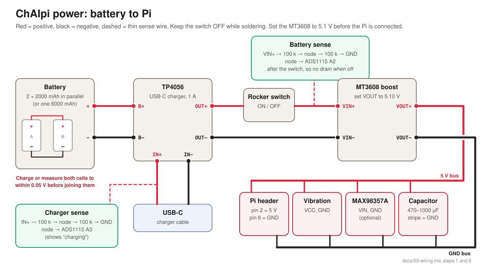

# 03 — Wiring (revision 3, 2026-10-23)

This replaces the old OLED-HAT wiring. The pins match `docs/12-revision-3.md` and `config/chaipi.example.toml`. If any of them disagree, the config file is what the software uses.

## How to use this guide
Build in **steps**, and do the test at the end of each step before starting the next. If something fails, you only have to check the last few wires.

**Try it with jumper wires first.** Your screen, ADS1115, RTC and joystick come with header pins. With a 2×20 header on the Pi and some female–female Dupont jumpers, you can wire and test everything without soldering. Solder it permanently once it all works.

## Before you start
- **Tools:** soldering iron, solder with flux, multimeter, wire strippers, flush cutters, heat-shrink or tape.
- **Wire:** 24 AWG for the battery and 5 V lines (about 1.5 A peak), 26–28 AWG for everything else.
- **Safety:**
  - LiPo cells can catch fire if shorted. Insulate every bare battery wire as soon as it's soldered, and never let the red and black leads touch.
  - Keep the rocker switch **OFF** while soldering.
  - The Pi's header has **no protection**. 5 V on a GPIO pin, or 5 V and GND swapped, kills it instantly. Check twice before switching on.
  - Don't plug a USB power cable into the Pi's own PWR socket while the battery boost is also connected.
- **Pin numbers:** "pin 12" means the physical header pin (1–40). "GPIO18" is the chip's name for it. Hold the Pi as in the first diagram: SD card at the top, header on the right, pin 1 top left. Pin 1 also has a square solder pad.
- **Rails:** On the perfboard, make three strips: **3.3 V**, **5 V** and **GND**. Run one wire from the Pi to each strip, then connect the modules to the strips. This keeps the number of wires on the Pi's header down.

---

## Step 1 — Power
| From | To | Wire |
|---|---|---|
| Cell A + and cell B + (joined) | TP4056 **B+** | red, 24 AWG |
| Cell A − and cell B − (joined) | TP4056 **B−** | black, 24 AWG |
| TP4056 **OUT+** | rocker switch, one leg | red, 24 AWG |
| rocker switch, other leg | MT3608 **VIN+** | red, 24 AWG |
| TP4056 **OUT−** | MT3608 **VIN−** | black, 24 AWG |
| MT3608 **VOUT+** | 5 V strip, then Pi **pin 2** | red, 24 AWG |
| MT3608 **VOUT−** | GND strip, then Pi **pin 6** | black, 24 AWG |
| 470–1000 µF capacitor | across the 5 V and GND strips, near the Pi. **Stripe side to GND** | |

1. **Match the cells.** Measure both. If they differ by more than 0.05 V, charge each one on its own with a TP4056 until its LED shows full. Then join + to + and − to −.
2. Wire the cells to the TP4056 **B+/B−**. Load wires go on **OUT+/OUT−**, never on B.
3. Wire the switch and the MT3608, but **don't connect the Pi yet**.
4. **Set the MT3608 to 5.1 V.** Switch on and measure VOUT with the multimeter. New MT3608s often put out 12 V or more. Turn the small brass screw slowly; it can take 10–20 turns before the voltage moves. Stop at **5.10 V**, then switch off.
5. Fit the capacitor, then connect VOUT to the Pi's pin 2 (5 V) and pin 6 (GND).

**Test 1:** Flash the SD card (see `image/README.md`) and switch on. The Pi's green LED flickers. Once you're in over SSH, `vcgencmd get_throttled` should say `throttled=0x0`. Pin 2 should still read at least 4.9 V while the Pi is busy.

## Step 2 — Screen (2.8" ILI9341)
| Screen pin | Pi pin | GPIO | Notes |
|---|---|---|---|
| VCC | **17** (3.3 V strip) | | If the picture is dim or unstable, move VCC to 5 V (pin 4). The data pins are fine either way |
| GND | **20** (GND strip) | | |
| CS | **24** | GPIO8 (CE0) | |
| RESET | **18** | GPIO24 | |
| DC | **22** | GPIO25 | |
| SDI (MOSI) | **19** | GPIO10 | |
| SCK | **23** | GPIO11 | |
| LED | **33** | GPIO13 | Do the backlight test below first |
| SDO (MISO) | — | | not needed for the screen |
| T_CLK, T_CS, T_DIN, T_DO, T_IRQ | — | | touch: not used |

**Backlight test (30 seconds, before connecting LED to the Pi).**
1. Power the screen's VCC and GND from 3.3 V.
2. Set the multimeter to **mA** and put it between **3.3 V** and the screen's **LED** pin.
3. Read the current:
   - **Under about 10 mA:** the board has its own transistor. Wire LED straight to pin 33. Done.
   - **20 mA or more:** the LEDs hang directly off that pin, which is too much for a GPIO. Either:
     - wire LED to 3.3 V (always full brightness; the brightness setting won't work), **or**
     - add a PNP transistor (S8550 or 2N3906, not in your kit): emitter → 3.3 V, collector → LED, base → 1 kΩ resistor → pin 33. Then set `invert = true` under `[backlight]` in `/etc/chaipi/chaipi.toml`.

**Test 2:** Switch on. The boot animation (the kulhad pawn) appears within about 20 seconds.
- **All white:** a data wire is wrong or loose. Check CS, DC, RESET, SCK and MOSI. `dmesg | grep -i fbtft` should mention `ili9341`.
- **Red and blue swapped:** remove `,bgr` from the `fbtft` line in `/boot/firmware/config.txt`.
- **Upside down:** change `rotate=90` to `rotate=270` on the same line.

## Step 3 — ADS1115 and the DS3231 clock (I2C)
Both share the same two data wires.

| Module pin | Pi pin | GPIO |
|---|---|---|
| ADS1115 VDD, DS3231 VCC | **1** (3.3 V strip) | |
| ADS1115 GND, DS3231 GND | **25** (GND strip) | |
| ADS1115 SDA, DS3231 SDA | **3** | GPIO2 |
| ADS1115 SCL, DS3231 SCL | **5** | GPIO3 |
| ADS1115 ADDR | GND | sets address 0x48 |
| ADS1115 ALRT, DS3231 SQW and 32K | — | not used |

- **DS3231 board (ZS-042):** before fitting a normal CR2032, remove its charging resistor (a small "201" resistor near the diode). The board is designed for rechargeable cells.
- Fit the CR2032 with **+ facing up**.

**Test 3:** `i2cdetect -y 1` shows `48` (ADS1115) and `68` or `UU` (the clock). `UU` means the driver has it, which is good. `sudo hwclock -r` prints a time.

## Step 4 — Joystick
| Joystick pin | Goes to | |
|---|---|---|
| +5V | **3.3 V strip** | **3.3 V, not 5 V**: the ADS1115 inputs must stay below 3.6 V |
| GND | GND strip (pin 34) | |
| VRx | ADS1115 **A0** | |
| VRy | ADS1115 **A1** | |
| SW | Pi **pin 13** | GPIO27 |

**Test 4:** Don't touch the stick while ChAIpi boots, because it measures the centre then. `journalctl -u chaipi-input -b | grep centre` shows about 1.65 V on both axes, and moving the stick moves the selection. If up/down or left/right come out wrong, set `swap_xy`, `invert_x` or `invert_y` in `/etc/chaipi/chaipi.toml`, then run `sudo systemctl restart chaipi-input`.

## Step 5 — Buttons
Each button goes between a GPIO pin and GND. The Pi's built-in pull-ups do the rest, so no resistors are needed.

| Button | Pi pin | GPIO |
|---|---|---|
| Confirm | **29** | GPIO5 |
| Backspace / undo | **31** | GPIO6 |
| Esc | **36** | GPIO16 |
| Tab | **37** | GPIO26 |
| Menu | **16** | GPIO23 |
| Fn | **11** | GPIO17 |
| other leg of every button | GND strip (pins 9, 14 or 30) | |

**4-leg tactile buttons:** the two legs on each side are already joined inside. Use two legs that are **diagonally opposite**, and you'll always get the switch.

**Test 5:** Press each button; the screen reacts. Until the buttons arrive, `chaipi-keys` over SSH does the same job from your keyboard.

## Step 6 — Battery and charger sensing
Each sense line is two 100 kΩ resistors (brown-black-yellow) in series. The middle point goes to the ADS1115.

| | Top of the pair | Middle point | Bottom of the pair |
|---|---|---|---|
| Battery | MT3608 **VIN+** (after the switch) | ADS1115 **A2** | GND |
| Charger | TP4056 **IN+** | ADS1115 **A3** | GND |

Battery sense sits after the switch, so it draws nothing while ChAIpi is off.

**Test 6:** In Settings → System → Battery, compare the voltage shown with your multimeter on the battery. If they differ, set `divider` under `[battery]` to `2.0 × (meter reading ÷ shown reading)`. Plug in USB-C and the status bar should show charging.

## Step 7 — Vibration motor
| Module pin | Pi pin | |
|---|---|---|
| VCC | 5 V strip (pin 4) | |
| GND | GND strip (pin 39) | |
| IN | **pin 32** | GPIO12 |

**Test 7:** With Settings → Controls → Vibration set to Light, button presses give a short buzz.

## Step 8 — Sound (optional, after buying the MAX98357A and speaker)
| Amp pin | Pi pin | |
|---|---|---|
| VIN | 5 V strip | |
| GND | GND strip (pin 39) | |
| BCLK | **pin 12** | GPIO18 |
| LRC | **pin 35** | GPIO19 |
| DIN | **pin 40** | GPIO21 |
| SD, GAIN | — | leave unconnected (mono, 9 dB) |
| speaker + / − | the amp's screw terminal | |

Don't use pin 38 (GPIO20) for anything: the sound hardware claims it.

**Test 8:** `speaker-test -t wav -c 2 -l 1` says "front left, front right".

## Step 9 — USB-C for data too (optional, needs the USB-C breakout)
See docs/12, "USB-C for charging and data". In short:
- The breakout's VBUS goes to TP4056 IN+.
- D+ and D− go to a cut micro-USB cable plugged into the Pi's **USB** socket (not PWR).
- Leave that cable's red wire unconnected.

**Test 9:** Settings → Transfer → USB drive mode, then plug into a computer. A drive named CHAIPI appears.

## Step 10 — The screen's microSD slot (optional)
| Screen pin | Pi pin |
|---|---|
| SD_CS | **26** (GPIO7) |
| SD_MOSI | **19** (shared with the screen) |
| SD_MISO | **21** (GPIO9) |
| SD_SCK | **23** (shared with the screen) |

Then uncomment the `mmc-spi-slot` line in `/boot/firmware/config.txt`. Check its parameter names in `/boot/firmware/overlays/README` first, because they vary between OS releases.

**Test 10:** Insert a card; ChAIpi says "SD card inserted".

---

## Every wire on one page
| # | From | To (Pi pin) | Colour |
|---|---|---|---|
| 1 | MT3608 VOUT+ | 2 | red |
| 2 | MT3608 VOUT− | 6 | black |
| 3 | 3.3 V strip | 1 and 17 | orange |
| 4 | GND strip | 9, 14, 20, 25, 30, 34, 39 (any) | black |
| 5 | Screen CS / RESET / DC / MOSI / SCK / LED | 24 / 18 / 22 / 19 / 23 / 33 | blue (LED pink) |
| 6 | I2C SDA / SCL | 3 / 5 | green |
| 7 | Joystick SW | 13 | yellow |
| 8 | Confirm / Backspace / Esc / Tab / Menu / Fn | 29 / 31 / 36 / 37 / 16 / 11 | yellow |
| 9 | Vibration IN | 32 | pink |
| 10 | Amp BCLK / LRC / DIN (optional) | 12 / 35 / 40 | purple |
| 11 | Screen SD_CS / SD_MISO (optional) | 26 / 21 | light blue |
| — | Serial console for debugging: TX / RX | 8 / 10 | leave free |

## When something's wrong
| Symptom | Likely cause |
|---|---|
| Pi won't boot, or reboots when the engine starts | 5 V too low: re-check the MT3608 at 5.1 V under load, fit the capacitor, use thicker and shorter 5 V wires |
| `get_throttled` isn't `0x0` | under-voltage at some point: same fixes as above |
| Screen stays white | a screen data wire is wrong or loose, or the `fbtft` line is missing from config.txt |
| Screen colours look wrong | `bgr` setting (step 2) |
| `i2cdetect` shows nothing | SDA and SCL swapped, the module has no 3.3 V, or a loose ground |
| Joystick moves by itself | it was touched during boot (centre measured wrong); restart `chaipi-input`, or raise `press` in the config |
| A button does nothing | both wires on legs that are joined inside: move one to the diagonal leg |
| Battery % jumps or is off | calibrate `divider` (step 6) |
| Clock wrong after power-off | CR2032 missing, flat or upside down |
| No sound | amp wiring (step 8); `aplay -l` should list a MAX98357A card |
