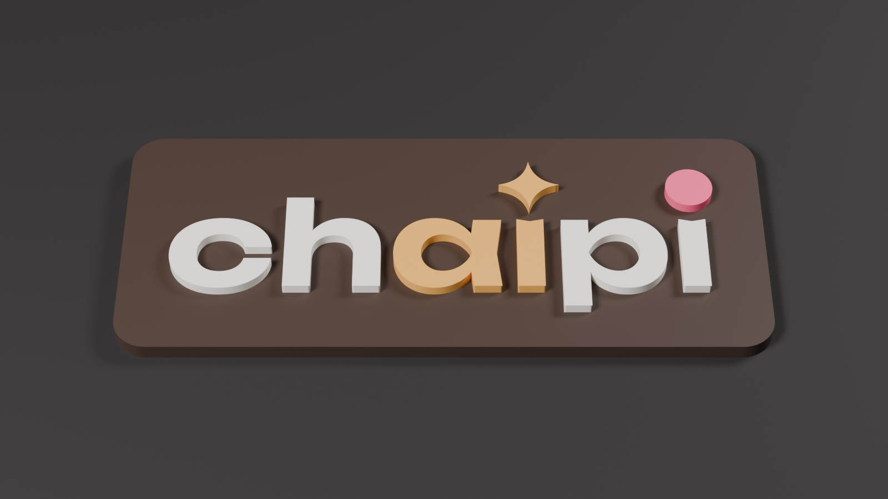

# ChAIpi logo badge (logo No. 8, the wordmark)



The wordmark "chaipi" is set in Unbounded SemiBold. The first dotless ı carries an amber AI spark and the second a raspberry dot, exactly as on the device's screen.

## Files
| File | What it is |
|---|---|
| `badge_one_piece.stl` | Single-colour badge: plate + raised letters, 58.7 × 24.4 × 2.6 mm. Print it, then paint the letters, or glue it onto the case |
| `badge_plate.stl` + `badge_ink.stl` + `badge_accent.stl` + `badge_berry.stl` | The same badge split by colour, all in one coordinate frame. For a multi-material printer (Bambu AMS, Prusa MMU) |
| `inlay_ink.stl` + `inlay_accent.stl` + `inlay_berry.stl` | Letters only, 1.2 mm tall, 0 to 1.2 mm in Z. For pressing into a matching recess on the enclosure lid |
| `chaipi-wordmark.svg` | 2D vector artwork, 50 mm wide, with dark-brown letters for light backgrounds. Use it to emboss or deboss the logo in Fusion, Onshape or FreeCAD |
| `chaipi-badge.glb` | Coloured 3D model for a quick look (macOS Quick Look, Blender, or any online glTF viewer) |
| `chaipi-badge-preview.png` | Rendered preview |
| `dimensions.json` | Plate and artwork sizes |
| `tools/` | Scripts that rebuild everything from the font |

## Sizes
- Artwork: 49.7 × 16.8 mm. The x-height is 7.6 mm.
- Plate: 58.7 × 24.4 × 1.6 mm with 3 mm corner radius.
- Letters: 1.2 mm raised. In the one-piece badge they sink 0.2 mm into the plate, so the print fuses.
- All STLs are watertight. To check: `Blender --background --factory-startup --python tools/check_stl.py -- .`

## Printing tips
- Print flat, 0.12–0.16 mm layers. The spark's points and the inner corners of "a" need fine layers.
- Colours used on screen: cream `#f3ede6`, masala amber `#e7a54d`, raspberry `#f2557f`, shell brown `#3a2a22`.
- With a single-colour printer: print the inlays in three filaments and press them into the plate or the lid. Give the recess 0.15 mm clearance per side.

## Rebuild at another size
```bash
python3 tools/font_prep.py Unbounded[wght].ttf Unbounded-SemiBold.ttf wordmark.json
python3 tools/wordmark_svg.py wordmark.json chaipi-wordmark.svg 50 dots.json   # 50 = width in mm
Blender --background --factory-startup --python tools/badge_blender.py -- wordmark.json dots.json .
```
`font_prep.py` needs `fonttools` and `skia-pathops`. Blender's bundled Python 3.13 works if your system Python is too new.

## Font licence
Unbounded is under the SIL Open Font License 1.1 (`FONT-LICENSE-Unbounded-OFL.txt`). The badge is artwork made from the font, which the OFL allows. The derived font file itself is not shipped here; the scripts rebuild it from the original.
